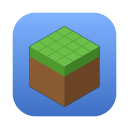
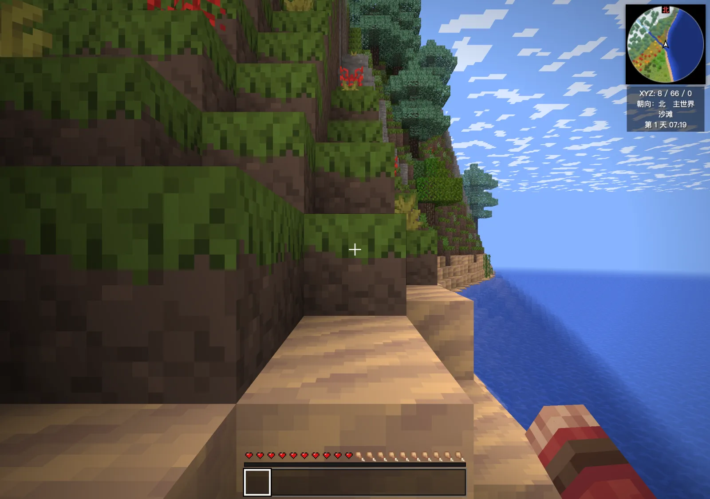
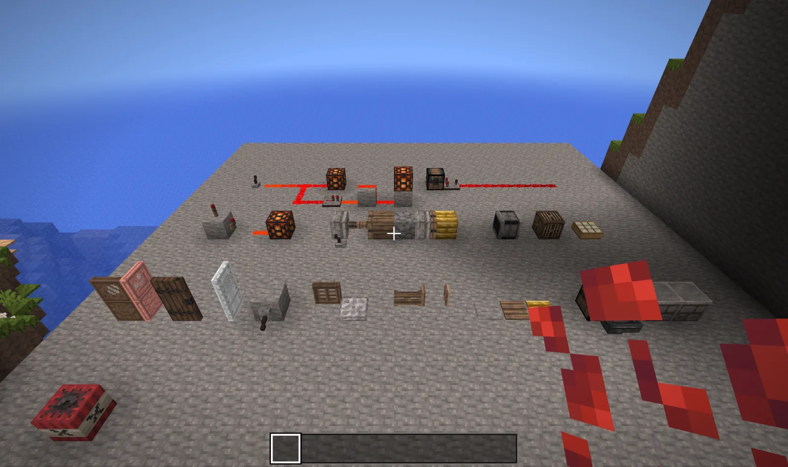

<div align="center">



# WebCraft

**A block sandbox game that runs in your browser — double-click `index.html` and play**

Infinite terrain, caves and ores, the Nether and the End with a dragon fight, redstone,<br>
villages and trading, enchanting and brewing — in plain JavaScript and Three.js,<br>
with no build step, no server and no install. Saves stay in your browser.

[](LICENSE)
[-lightgrey)](assets/CREDITS.md)
[](https://tomeageer.com/projects/webcraft/)
[](#quick-start)
[](#privacy)

[**▶ Play online**](https://tomeageer.com/projects/webcraft/) · [Quick start](#quick-start) · [How it works](#how-it-works) · [FAQ](#faq) · [**中文文档**](README.zh-CN.md)



</div>

---

> WebCraft is an unofficial fan project inspired by Minecraft. It is not affiliated with or
> endorsed by Mojang or Microsoft, and ships **no Mojang assets** — all textures, sounds and
> music come from the open-source game [VoxeLibre](https://github.com/VoxeLibre/VoxeLibre).
> "Minecraft" is a trademark of Mojang Synergies AB.

## Why WebCraft

Browser block games usually stop at the 2009-era "place and break blocks" demo. WebCraft goes for the
full survival loop and keeps it hackable:

- 🌍 **A real survival game** — infinite terrain with caves, ores and a deepslate layer, day/night, rain,
  snow and thunderstorms, hunger, saturation, oxygen, XP, fall damage, breeding and sleeping through the night
- 🔥 **Three dimensions** — the Nether (five biomes, lava seas, fortresses, ruined portals, 8:1 coordinates)
  and the End (strongholds and eyes of ender, obsidian pillars, end crystals, the dragon fight, the egg)
- ⚡ **Redstone that computes** — 0–15 power levels, torches, repeaters, comparators, observers, pistons and
  sticky pistons, hoppers, dispensers, droppers, note blocks, daylight detectors, TNT
- 🏘 **Villages** — four village styles, villagers with professions and five trading levels, iron golems,
  workstations including smithing upgrades, dungeons with spawners
- ✨ **Enchanting and brewing** — enchanting table with bookshelves, anvil, grindstone, 18 potions with
  extended/strong/splash/lingering variants, six armour tiers with every enchantment effect
- 🧩 **Plugin architecture** — every major system is a `js/feat_*.js` plugin that registers blocks, items,
  recipes, mobs, models, screens, commands and dimension generators through documented hooks
- 📦 **Zero setup** — classic scripts, no bundler, no modules, no server: it runs from `file://`.
  Worlds are saved in IndexedDB
- 🆓 **Open** — MIT code, CC BY-SA media, ~16,600 lines of JavaScript you can read

|  | WebCraft | Minecraft Classic (browser) | ClassiCube | VoxeLibre |
|---|---|---|---|---|
| Runs in a browser, no install | **Yes** | Yes | Yes (web client) | No — needs Luanti |
| Source | **Open (MIT)** | Closed | Open (BSD-style) | Open (GPLv3) |
| Content | **Survival: Nether, End, redstone, villages, enchanting, brewing** | 2009 Classic: 32 blocks, creative | Classic-era blocks | Full survival game |
| Language | JavaScript + Three.js | JavaScript | C | Lua |
| Media licence | **CC BY-SA (VoxeLibre)** | Mojang | Classic-style community packs | CC BY-SA |

## Quick start

```bash
git clone https://github.com/TomEageer/webcraft.git
open webcraft/index.html          # macOS — or just double-click it
```

Any modern desktop browser works (Chrome, Edge, Safari, Firefox). Or skip the download and
[**play online**](https://tomeageer.com/projects/webcraft/).

**Controls:** WASD move · Space jump (double-tap to fly in creative) · Shift sneak · Ctrl sprint ·
left mouse mine/attack · right mouse place/use (hold to eat or draw a bow) · 1–9 / wheel switch items ·
E inventory · Q drop · T chat · / commands · M map · F3 debug · F2 screenshot · F5 camera · Esc pause

> The in-game UI is in Simplified Chinese.

## How it works

<p align="center"></p>

| Part | Files | Role |
|---|---|---|
| Core | `world.js`, `mesher.js`, `player.js`, `entities.js`, `main.js` | 16×16×384 chunks, face-culled meshing with smooth lighting and AO, sky and block light, fluids, physics, mobs |
| Content data | `blocks.js`, `recipes.js`, `textures.js`, `icons.js` | Block definitions (`defBlock`), recipes, a texture atlas built at startup, item icons |
| Plugins | `feat_*.js` (19 files) | Nether, End, redstone, villages, enchanting/brewing, building and transport, particles, mob models |
| UI & saves | `ui.js`, `hud.js`, `creative.js`, `save.js` | Title screen and menus, HUD and minimap, creative inventory, IndexedDB saves |
| Media | `assets/pack_tex.js`, `assets/sounds`, `assets/music` | Generated from VoxeLibre by `tools/build_pack.py`; textures are embedded as data URLs because `file://` cannot fetch |

Everything lives in one global scope and loads in a fixed order; plugins only register entries at top level,
and real initialisation happens after `window.load`. The full hook reference — blocks, box shapes, mobs,
models, screens, commands, dimension generators — is in [docs/ARCHITECTURE.md](docs/ARCHITECTURE.md).
Per-module notes and known issues are in `docs/NOTES_*.md`.

### Optional: your own vanilla assets

If you own Minecraft Java Edition, `tools/build_vanilla.py` (textures and sounds) and
`tools/build_worldgen.mjs` (vanilla overworld terrain via [deepslate](https://github.com/misode/deepslate))
can build a **local-only** overlay into `assets/vanilla/` from your own installed client. The game picks it up
automatically and falls back to VoxeLibre media and its own terrain generator when it is absent.
That folder is git-ignored: **never commit or distribute it** — those files are Mojang's.

## Privacy

No accounts, no analytics, no network calls. Worlds and settings live in your browser's IndexedDB and
never leave your machine.

## FAQ

**Is this Minecraft?** No. It is an independent re-implementation that follows the game's rules and
content as reference, using only openly licensed media.

**Why are the textures different from the real game?** Because Mojang's assets are copyrighted. WebCraft
uses VoxeLibre's, which are mostly based on the Pixel Perfection pack (CC BY-SA 4.0).

**Does it work on phones?** Not yet — it needs a keyboard and mouse.

**Multiplayer?** Not yet. A LAN prototype exists but is not released.

**What is not implemented?** Multiplayer, End cities and elytra, ocean monuments, woodland mansions,
signs and banners, command blocks.

## Requirements

A desktop browser with WebGL. Opening `index.html` directly from disk is supported.

## Support

WebCraft is free. If you enjoyed it, see [DONATE.md](DONATE.md).

## Credits

- Textures, sounds and music: [VoxeLibre](https://github.com/VoxeLibre/VoxeLibre) and its contributors —
  full attribution in [assets/CREDITS.md](assets/CREDITS.md)
- Rendering: [Three.js](https://threejs.org) r128 (MIT)

## Contact

[tomeageer@gmail.com](mailto:tomeageer@gmail.com) · [tomeageer.com](https://tomeageer.com)

## License

Code: [MIT](LICENSE). Media in `assets/`: their original licenses (mainly CC BY-SA 3.0 / 4.0) — see
[assets/CREDITS.md](assets/CREDITS.md).
